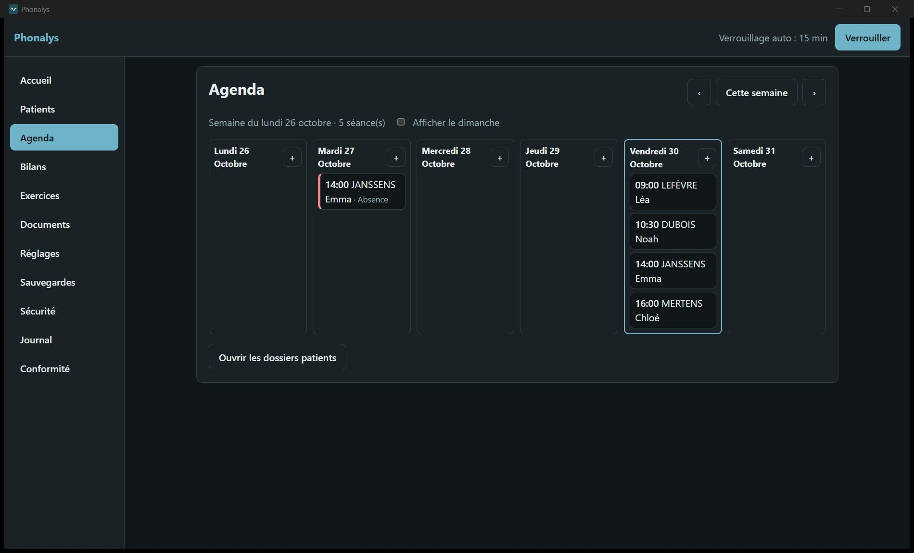
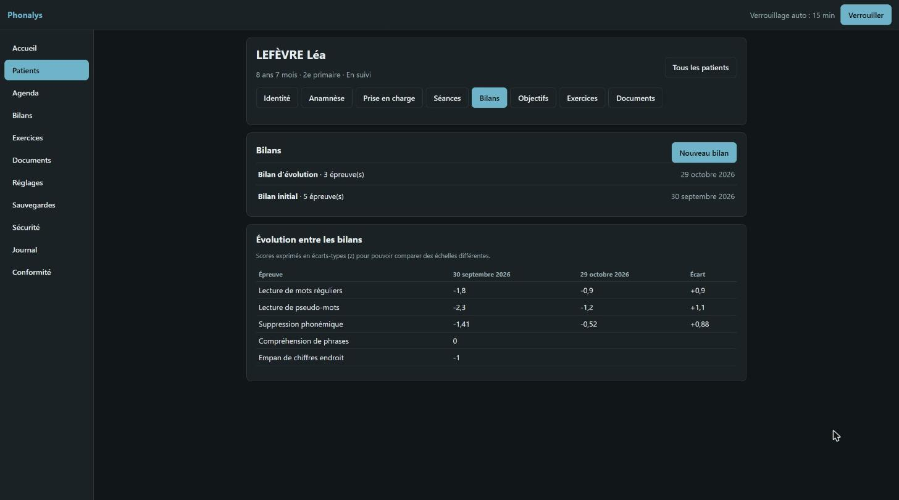
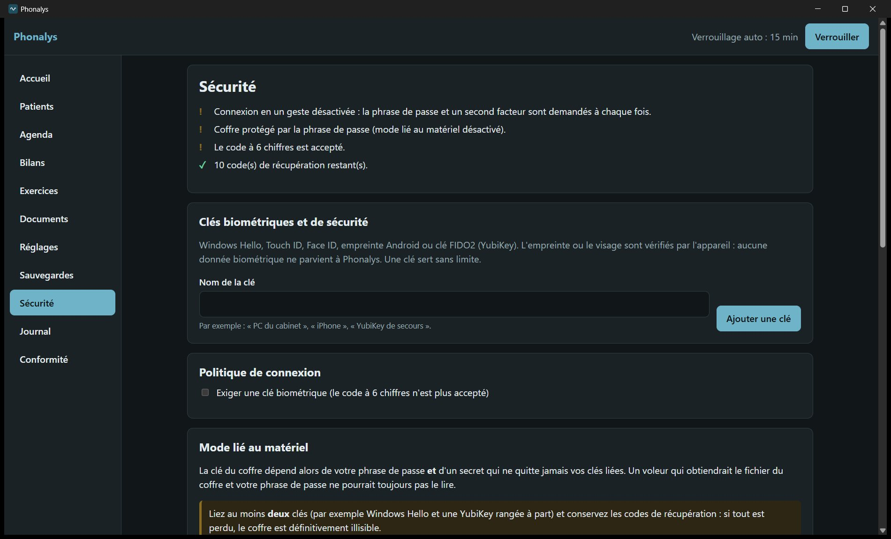
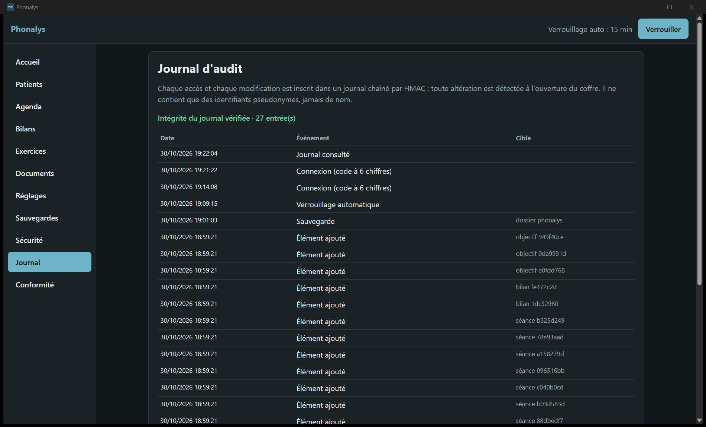

# Phonalys

Logiciel pour les logopèdes : dossier patient, bilans, exercices et assistant de rédaction, **entièrement hébergés chez vous**.

- **Vos données restent au cabinet** : aucun compte en ligne, aucun envoi à l'éditeur, aucune télémétrie. L'application vérifie seulement, au démarrage, si une nouvelle version existe ; elle ne l'installe qu'avec votre accord.
- **Sécurité** : coffre chiffré, connexion à deux facteurs (phrase de passe et biométrie), verrouillage automatique, journal d'audit.
- **IA locale uniquement** : l'assistant de rédaction utilise un modèle installé sur votre matériel (Ollama, LM Studio…). Les IA en ligne sont bloquées.
- **Windows, Linux, iPhone et Android** (ces deux derniers via le serveur du cabinet).

## Aperçu

Application de bureau Windows, version 0.1.3. Tous les patients sont fictifs.


| | |
|---|---|
|  |  |
| **Agenda** de la semaine, absences signalées. | **Dossier patient** : identité, anamnèse, séances, bilans, objectifs, documents. |
|  |  |
| **Évolution entre les bilans**, scores ramenés sur une même échelle. | **Exercices** de rééducation et suivi de la progression. |
|  |  |
| **Sécurité** : Windows Hello, Face ID, YubiKey. | **Journal d'audit** chaîné : toute altération est détectée. |


**Conformité RGPD** : registre des traitements, notice patients, violations et analyse d'impact, préremplis.

## Télécharger

👉 **[Dernière version](https://github.com/Bibi002/phonalys-releases/releases/latest)**

| Vous avez | Fichier |
|---|---|
| Windows | `Phonalys_<version>_x64-setup.exe` |
| Linux | `.deb`, `.rpm` ou `.AppImage` |
| Des téléphones ou tablettes à connecter | En plus, `phonalys-server-<version>-…` sur l'ordinateur du cabinet |

Avant d'installer, lisez le **[guide d'installation](INSTALLATION.md)** et vérifiez l'empreinte du fichier avec `SHA256SUMS.txt`.

> Les versions actuelles ne sont pas encore signées : Windows affiche un avertissement SmartScreen. N'installez que si l'empreinte correspond.

## Vérifier l'authenticité (facultatif, pour les informaticiens)

Chaque version est signée automatiquement avec [Sigstore](https://www.sigstore.dev) et porte une attestation de provenance GitHub. La signature prouve que les fichiers ont été publiés par ce dépôt et n'ont pas été modifiés.

Avec l'outil [GitHub CLI](https://cli.github.com) :

```sh
gh attestation verify Phonalys_<version>_x64-setup.exe -R Bibi002/phonalys-releases
```

Avec [cosign](https://docs.sigstore.dev/cosign/system_config/installation/) :

```sh
cosign verify-blob SHA256SUMS.txt --bundle SHA256SUMS.txt.sigstore.json \
  --certificate-oidc-issuer https://token.actions.githubusercontent.com \
  --certificate-identity-regexp '^https://github\.com/Bibi002/phonalys-releases/\.github/workflows/signer\.yml@'
sha256sum --check --ignore-missing SHA256SUMS.txt
```

## Sécurité

Pour signaler une faille, voir [SECURITY.md](SECURITY.md).

## Licence

Logiciel **propriétaire**. Ce dépôt contient les fichiers d'installation. Le code source est consultable sur **[Bibi002/phonalys](https://github.com/Bibi002/phonalys)**, pour que chacun puisse vérifier que les données restent au cabinet ; il reste soumis à la même licence. Voir [LICENSE](LICENSE). © 2026 M. Baron.

Phonalys est un outil de gestion et d'aide à la rédaction : il ne pose aucun diagnostic et ne remplace pas le jugement du logopède.
